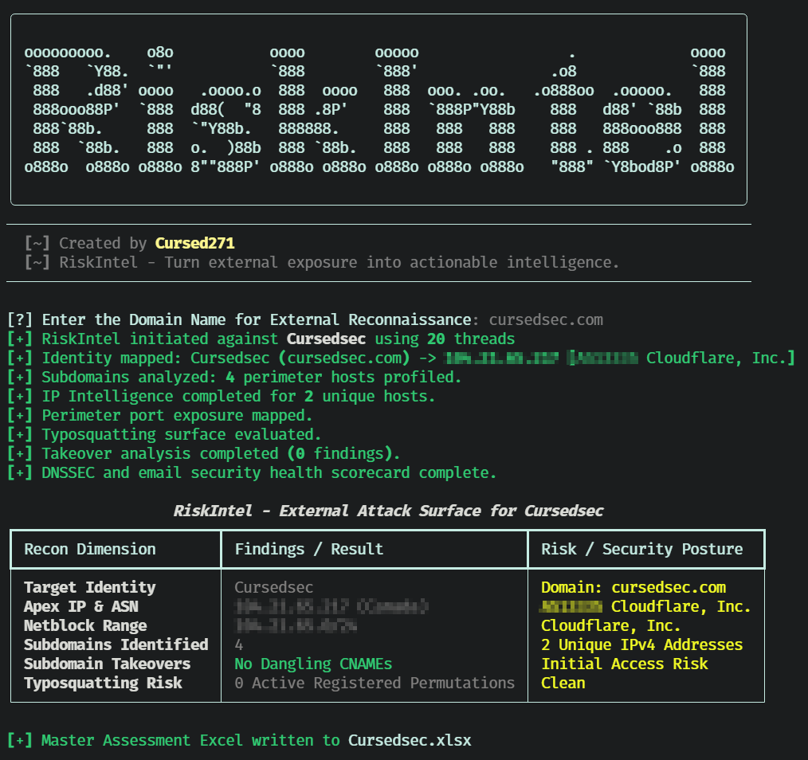

<div align="center">

  

  <h1>RiskIntel</h1>

  <p align="center">
    
  </p>

  <p align="center">
    
    
    
    
    <a href="./LICENSE">
      
    </a>
  </p>

  <p>Turn External Exposure Into Actionable Intelligence.</p>

</div>


## Overview

RiskIntel is a Python external attack-surface and domain-intelligence utility for authorized security review.

It combines passive subdomain discovery, DNS resolution, web-stack inspection, IP enrichment, Shodan InternetDB exposure checks, typosquatting analysis, dangling-CNAME checks, and DNS/email-security assessment into a terminal summary and multi-sheet Excel report.

> RiskIntel performs external, mostly passive reconnaissance. It does not exploit targets, authenticate to services, or establish a complete security posture by itself.

## Features

| Capability | What it does |
| :--- | :--- |
| Domain reconnaissance | Queries public subdomain sources and certificate-transparency data. |
| Subdomain inspection | Resolves A and CNAME records, checks TLS, retrieves web responses, and identifies technologies. |
| Web-stack fingerprinting | Uses optional Wappalyzer integration and response headers. |
| WAF detection | Uses optional WAFW00F integration. |
| IP enrichment | Queries IP-API for infrastructure metadata and AlienVault OTX for threat-pulse context. |
| Exposure checks | Queries Shodan InternetDB for observed ports, CVEs, and infrastructure tags. |
| Typosquatting analysis | Generates candidate domains through deletion, repetition, and keyboard-adjacency permutations. |
| Takeover checks | Compares HTTP responses against selected cloud-provider takeover signatures. |
| DNS and email audit | Checks DNSSEC, SPF, DMARC, MX, MTA-STS, TLS-RPT, DANE, CAA, reverse DNS, and nameserver resilience. |
| Excel reporting | Produces a multi-sheet `.xlsx` assessment workbook. |

## Screenshots:

### Interface


## Assessment Coverage

| Area | Checks performed |
| :--- | :--- |
| Executive summary | Target identity, apex IP, ASN, netblock, hosting provider, country, domain, and nameserver information |
| Subdomains | DNS resolution, CNAME records, technologies, HTTP security headers, WAF detection, and TLS version |
| IP intelligence | ISP, ASN, organization, country, threat-pulse count, reputation category, and heuristic abuse score |
| Typosquatting | Candidate generation and DNS resolution status |
| Open ports | Shodan InternetDB ports, CVE references, and infrastructure tags |
| Subdomain takeover | Dangling CNAME indicators and selected provider response signatures |
| DNSSEC | DNSKEY, DS, RRSIG, NSEC/NSEC3, and chain-of-trust observations |
| Email security | SPF, DMARC, MX, MTA-STS, TLS-RPT, and DANE TLSA checks |
| Certificate controls | CAA records, wildcard issuance, A/AAAA resolution, and reverse DNS |
| Record hygiene | Apex CNAME, wildcard DNS, conflicting TXT records, nameserver ASN diversity, IPv6 support, TCP/53 fallback, and lame delegation |

## Technology

| Component | Purpose |
| :--- | :--- |
| Python | Application runtime |
| Typer | Command-line options and help |
| Rich | Banner, progress indicators, and summary table |
| requests | HTTP reconnaissance and third-party API queries |
| dnspython | DNS resolution, DNSSEC, mail, and nameserver checks |
| Wappalyzer | Optional web-technology identification |
| WAFW00F | Optional web-application firewall detection |
| Shodan InternetDB | External port and CVE exposure lookup |
| openpyxl | Excel workbook generation |
| ThreadPoolExecutor | Concurrent subdomain and IP enrichment |

## Installation

### Prerequisites

- Python 3 with `pip`.
- Internet access for public reconnaissance sources and external enrichment APIs.
- DNS access.
- Optional Wappalyzer and WAFW00F installations for enhanced fingerprinting.
- openpyxl for Excel report generation.

Install the core dependencies:

```bash
python3 -m pip install rich typer requests dnspython openpyxl urllib3
```

Install optional fingerprinting integrations:

```bash
python3 -m pip install Wappalyzer wafw00f
```

Clone and run:

```bash
git clone https://github.com/Cursed271/RiskIntel.git
cd RiskIntel
python3 RiskIntel.py --help
```

Use an isolated Python environment. If your environment uses `python` rather than `python3`, substitute that interpreter consistently.

## Usage

Use RiskIntel only for domains you are authorized to assess.

| Use case | Command |
| :--- | :--- |
| Interactive assessment | `python3 RiskIntel.py` |
| Display help | `python3 RiskIntel.py --help` |
| Assess a domain | `python3 RiskIntel.py -d example.com` |
| Set Excel destination | `python3 RiskIntel.py -d example.com -o reports/example.xlsx` |
| Set worker count | `python3 RiskIntel.py -d example.com -t 10` |
| Combine options | `python3 RiskIntel.py -d example.com -o reports/example.xlsx -t 10` |

## Command-Line Options

| Option | Short | Default | Purpose |
| :--- | :--- | :--- | :--- |
| `--domain` | `-d` | Interactive prompt | Target domain to inspect |
| `--output` | `-o` | `<target>.xlsx` | Excel report destination |
| `--threads` | `-t` | `20` | Concurrent worker count |
| `--help` | `-h` | — | Show help |

The tool automatically appends `.xlsx` when the supplied output path does not already use that extension.

## Output & Interpretation

RiskIntel prints a terminal attack-surface summary and writes a multi-sheet Excel workbook.

### Excel Worksheets

| Worksheet | Contents |
| :--- | :--- |
| `Executive Summary` | Target identity, infrastructure, ASN, nameservers, and DNS provider context |
| `Subdomains` | Subdomain, resolved IPs, CNAME, technologies, HTTP headers, WAF, and TLS version |
| `IP Address` | IP, ISP, threat-pulse count, abuse score, and threat categories |
| `Typosquatting` | Permuted domain, resolution result, and registration status |
| `Open Ports` | IP, observed ports, CVEs, and infrastructure tags |
| `Subdomain Takeover` | Subdomain, CNAME target, provider signature, and severity |
| `DNS Email Health` | Security category, check, status, risk severity, and detailed finding |

### Important Interpretation Rules

- A missing DNSSEC, DMARC, SPF, CAA, or MTA-STS control is a configuration observation, not automatic proof of compromise.
- Shodan InternetDB data is external intelligence and may be incomplete or outdated.
- Typosquatting results distinguish DNS resolution from domain registration; a resolved candidate is not necessarily malicious.
- Takeover findings are signature-based and require manual validation before remediation or disclosure.
- The abuse score is a local heuristic derived from the observed OTX pulse count, not an official risk score.

## Known Limitations

- Results depend on third-party services, DNS resolution, and external API availability.
- The tool disables TLS certificate verification for HTTP reconnaissance.
- Subdomain discovery is not exhaustive.
- Port and CVE data are limited to Shodan InternetDB coverage.
- Takeover detection covers a limited signature set.
- Typosquatting generation is heuristic and capped at 20 candidates.
- No authentication, exploitation, credential testing, or active web-vulnerability scanning is performed.
- Errors from individual sources are often suppressed rather than surfaced.
- Reports can contain sensitive infrastructure and exposure data; handle them accordingly.

## Safe Use

- Obtain authorization before assessing a domain or its infrastructure.
- Use a low worker count for sensitive or rate-limited environments.
- Validate takeover, exposure, and reputation findings through independent sources.
- Do not treat a lack of findings as proof of security.
- Protect generated Excel reports and avoid sharing unredacted internal infrastructure data.
- Review third-party terms and data-handling obligations before using external enrichment services.

## Troubleshooting

| Problem | What to check |
| :--- | :--- |
| No subdomains found | Public-source availability, domain scope, and rate limits |
| Missing IP intelligence | External API access, rate limits, and network egress |
| No open ports reported | Shodan InternetDB coverage and API response |
| DNS checks incomplete | dnspython installation and DNS resolver access |
| No WAF or technology data | Optional Wappalyzer and WAFW00F installation |
| Excel export fails | openpyxl installation and destination permissions |
| Slow execution | Worker count, DNS latency, external API latency, and subdomain volume |

## Version History

| Version | Scope |
| :--- | :--- |
| Version 1 | Passive reconnaissance, infrastructure enrichment, exposure checks, DNS/email assessment, and Excel reporting |


## License & Usage

RiskIntel is distributed under the CursedSec Ownership Edict (COE).

Read [LICENSE](./LICENSE) for the applicable permissions, restrictions, contribution terms, and disclaimers. Public source availability is not a substitute for those terms.

## Feedback & Contributions

Use the repository's bug-report or feature-request template when issue submission is available.

Include the version, operating system, command, sanitized output, and reproduction steps. Never publish client scan results, credentials, sensitive infrastructure details, or evidence containing confidential data.

Check the security-reporting instructions before disclosing a vulnerability. Review the license and contribution terms before submitting modifications.

## Connect & Collaborate

<div align="center">

  <a href="https://github.com/Cursed271">
    
  </a>
  <a href="https://www.cursedsec.com/">
    
  </a>
  <a href="https://www.linkedin.com/in/cursed271/">
    
  </a>

  <p>Recon with permission. Correlate with evidence. Report with clarity.</p>
  <sub>CursedSec.com · Cursed271 · RiskIntel</sub>

</div>


